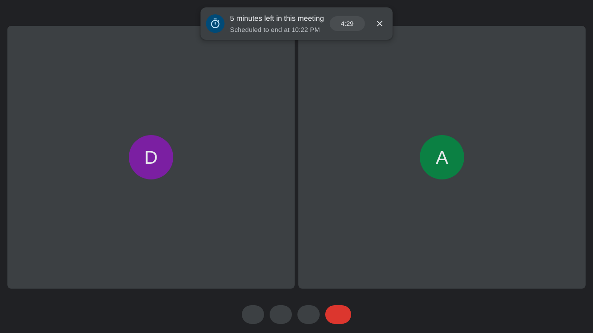
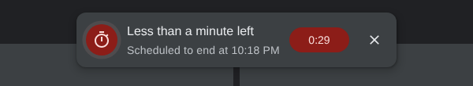
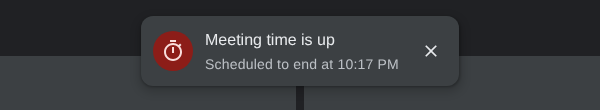
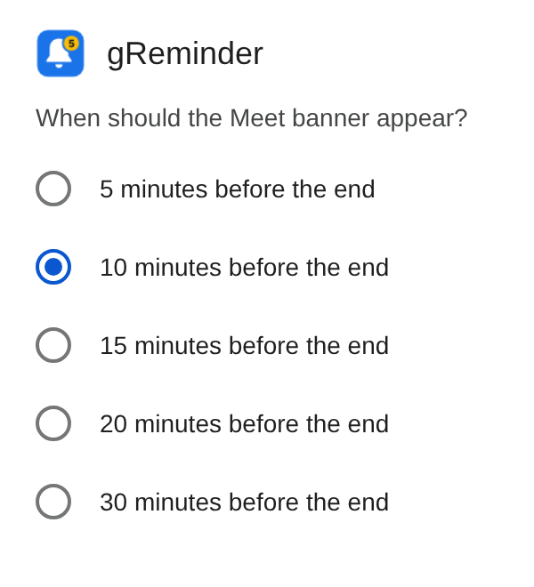

# gReminder for Google Meet

A Chrome extension (Manifest V3) that puts a banner at the top of a Google Meet
call when **5 minutes are left** in the scheduled meeting (or 10, 15, 20 or 30,
if you pick another time), so everyone in the call can start wrapping up.



- **No OAuth, no consent screen.** It never calls the Calendar API. The end
  time comes from the Meet page itself. The only permission is `storage`,
  which Chrome grants without a prompt, to remember the reminder time.
- **Banner only in Meet.** Nothing is added to Meet's toolbar or control bar.
  The one setting lives in the extension's popup in Chrome's own toolbar.
- **Looks like Meet.** Meet's dark surface, Google Sans, Material icons and
  state layers. It lives in a closed shadow root, so it can't affect Meet's
  styles and Meet can't break its own.
- **100% TypeScript.** Scripts, styles, the manifest and the build all live in
  `.ts` files.

| Last five minutes | Final minute | After the end time |
| --- | --- | --- |
| counts down, blue icon | turns red, icon pulses | "Meeting time is up", clears after 2 min |
|  |  |  |

The banner can be dismissed with ✕. It stays dismissed for that meeting unless
the event is moved to a later end time, in which case it arms again.

## Choosing the reminder time

Click the gReminder icon in Chrome's extensions menu (the puzzle piece; pin it
if you like) and pick 5, 10, 15, 20 or 30 minutes. The choice is saved at once
with `chrome.storage.sync`, so it follows your Chrome profile, and open Meet
tabs pick it up without a reload. The default is 5 minutes.



## Install (unpacked)

```bash
npm install
npm run build
```

1. Open `chrome://extensions` and switch on **Developer mode**.
2. **Load unpacked** and pick the `dist/` folder.
3. Join a Meet call that has a calendar invite.

After rebuilding, press reload on the extension card and reload the Meet tab.
CI also uploads a ready-built `dist/` as an artifact on every run.

## How the end time is found

Two sources, both read-only and both on the Meet page:

1. **Meet's own calendar request.** When you join a scheduled meeting, Meet
   fetches its calendar event
   (`MeetingCalendarAgendaService/FetchCalendarEvent`). `src/page/tap.ts` runs
   in the page's world, reads a clone of that response, and decodes the start
   and end timestamps by protobuf field number (event `1`, start `1.10.1`, end
   `1.11.1`). Responses pass through untouched and nothing else is read.
2. **The meeting-details text.** If someone opens Meet's meeting details, the
   schedule line it shows ("Thu, Sep 10, 2026 10:00 AM – 10:30 AM") is parsed
   from the DOM. US and European formats, 12 and 24-hour clocks, and meetings
   that cross midnight are handled. The panel is never opened for you.

Before the details panel is opened, the schedule exists nowhere in Meet's DOM,
which is why source 1 exists: with the DOM alone, the reminder would only work
for people who open the details panel.

Instant meetings (`meet.google.com/new`) have no calendar event, so nothing is
shown. That is intended: there is no end time to remind anyone about.

Everything posted from the page script is treated as untrusted by the content
script: origin, sender, meeting code and a plausibility window are checked
again before it is used.

## Publishing to the Chrome Web Store

Everything for the store is in `store/`: the listing text, permission
justifications and privacy-form answers in [store/listing.md](store/listing.md),
the images in `store/images/`, and the privacy policy in
[docs/privacy.md](docs/privacy.md) (also as a standalone
`store/privacy-policy.html`).

```bash
npm run store:zip      # build and zip dist/ as store/greminder-<version>.zip
npm run store:assets   # re-render the screenshots, promo tiles and store icon
```

`store:assets` renders the real banner over a mock Meet call with Playwright
(not a dependency; install it globally if it is missing). Bump `version` in
`package.json` before each new upload.

## Development

```bash
npm run watch      # rebuild dist/ on change
npm test           # vitest, against a simulated DOM
npm run typecheck
npm run check      # all of the above, as CI runs it
```

To see what was detected on a live call: DevTools → Console, switch the
context dropdown from `top` to **gReminder: Meeting End Timer for Google Meet**, and run
`greminder()`.

```
src/
  manifest.ts             manifest, written to dist/manifest.json
  shared/                 meeting code, message contract, sanity checks
  page/tap.ts             MAIN world: reads Meet's calendar request
  page/calendar-event.ts  decodes the event's start and end
  page/protobuf.ts        minimal protobuf reader
  content/index.ts        isolated world entry point
  content/controller.ts   per-tab state; follows Meet's in-page navigation
  content/reminder.ts     when the banner shows and what it says
  content/schedule-text.ts  parses the details-panel schedule line
  content/banner.ts       the banner (closed shadow DOM)
  content/styles.ts       its stylesheet
  popup/                  the settings popup (markup + script)
  shared/settings.ts      the reminder-time setting and chrome.storage access
scripts/build.ts          esbuild bundle + manifest + popup + icons
tests/                    unit and integration tests
```

The reminder time choices live in `src/shared/settings.ts`. Other timing lives
in `src/content/reminder.ts`: `LEAD_MS` (the 5 minute default),
`URGENT_MS` (final minute) and `LINGER_MS` (how long "time is up" stays).

## License

MIT, see [LICENSE](LICENSE). Contributions are welcome, see [CONTRIBUTING.md](CONTRIBUTING.md).

gReminder is an independent project, not made, affiliated with or endorsed by Google. Google Meet is a trademark of Google LLC.
